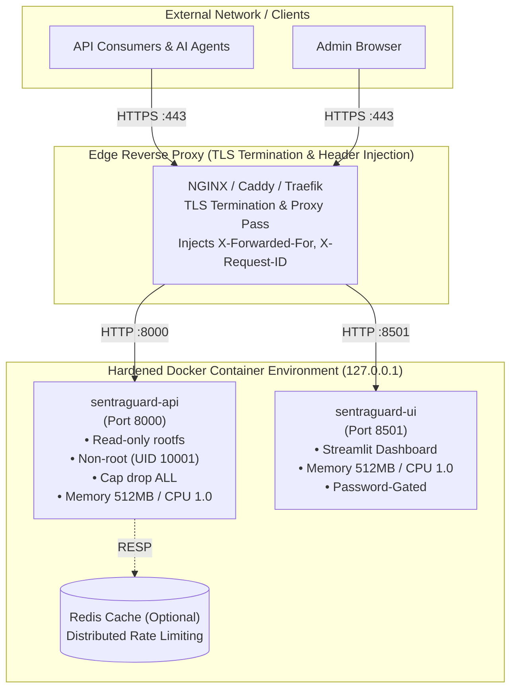

# Deployment and Operations Runbook

This guide covers production deployment topologies, container runtime sandboxing, reverse-proxy integration, health monitoring, operations runbooks, and disaster recovery for SentraGuard Lite v1.2.

---

## 1. Architecture & Deployment Topologies

SentraGuard Lite supports three standard deployment patterns depending on security boundaries, load requirements, and orchestration environments.

### Topology Overview



### Topologies Comparison

| Pattern | Intended Use Case | Ingress Security | Port Binding | Recommended Scaling |
|---|---|---|---|---|
| **Local Development** | Rapid testing & local debugging | Loopback only | `127.0.0.1:8000` / `127.0.0.1:8501` | 1 replica |
| **Production Docker Compose** | Single-node production with reverse proxy | NGINX/Caddy TLS termination | Host loopback (`GUARDRAILS_BIND_ADDRESS=127.0.0.1`) | 1-2 API replicas |
| **Clustered / Kubernetes** | Multi-node high-availability | Ingress Controller / Service Mesh | Internal Pod IP / ClusterIP | Horizontal Pod Autoscaler (HPA) |

---

## 2. Container Runtime Hardening

The provided `Dockerfile.api`, `Dockerfile.ui`, and `docker-compose.yml` enforce multiple overlapping container security controls by default.

### Security Guarantees & Implementation

```yaml
services:
  api:
    build:
      context: .
      dockerfile: Dockerfile.api
    container_name: sentraguard-api
    ports:
      # Explicit loopback binding prevents exposure to host network interfaces
      - "${GUARDRAILS_BIND_ADDRESS:-127.0.0.1}:8000:8000"
    restart: unless-stopped

    # 1. Read-Only Root Filesystem
    read_only: true

    # 2. Ephemeral In-Memory Scratch Space
    tmpfs:
      - /tmp

    # 3. Kernel Capability Dropping
    cap_drop:
      - ALL

    # 4. Privilege Escalation Prevention
    security_opt:
      - no-new-privileges:true

    # 5. Cgroup Resource Boundaries
    mem_limit: 512m
    cpus: 1.0
    pids_limit: 128
```

1. **Unprivileged Non-Root Execution (`USER appuser`)**:
   - The container creates user `appuser` (UID `10001`, GID `10001`) with `/sbin/nologin` and no home directory.
   - Code files in `/app` are owned by `root:root` and read-only for `appuser`. The process cannot overwrite its own bytecode or binary dependencies.
2. **Immutable Filesystem (`read_only: true`)**:
   - Attackers cannot write persistent malware, rootkits, or payload scripts to `/`, `/app`, `/usr`, or `/etc`.
   - Temporary writable scratch storage is strictly limited to isolated `tmpfs` mounts (`/tmp`).
3. **Capability Stripping (`cap_drop: [ALL]`)**:
   - Drops all Linux kernel capabilities (including `CAP_NET_RAW`, `CAP_SYS_ADMIN`, `CAP_CHOWN`, `CAP_SETUID`).
   - Disallows kernel-level privilege elevation or raw packet manipulation.
4. **No New Privileges (`no-new-privileges:true`)**:
   - Prevents child processes from gaining elevated privileges via setuid or setgid binaries.
5. **Cgroup Resource Quotas**:
   - **Memory**: Hard cap at `512m` per container prevents memory exhaustion (OOM) of adjacent host workloads.
   - **CPU**: Throttled to `1.0` vCPU share to prevent algorithmic ReDoS or regex attacks from monopolizing host CPUs.
   - **PID Limit**: Capped at `128` (API) and `256` (UI) to prevent fork-bomb attacks.
6. **Loopback Binding Default**:
   - Published ports default to `127.0.0.1` (`GUARDRAILS_BIND_ADDRESS`), preventing unintended public exposure when running Docker on multi-homed cloud instances.

---

## 3. Reverse-Proxy Integration & Trusted Proxies

In production, never expose the Uvicorn or Streamlit servers directly to the public Internet. Terminate TLS at a dedicated reverse proxy (NGINX, Caddy, or Traefik) and configure trusted IP validation to prevent client IP spoofing.

### Client IP Security & `GUARDRAILS_TRUSTED_PROXIES`

SentraGuard Lite inspects the connecting socket address and forwards client identity for rate limiting:
- If the direct connecting IP matches `GUARDRAILS_TRUSTED_PROXIES` (e.g. `127.0.0.1`, `10.0.0.0/8`, `172.16.0.0/12`), the gateway trusts the rightmost un-spoofed IP in `X-Forwarded-For`.
- If the direct connecting IP is **not** trusted, `X-Forwarded-For` is ignored and the socket peer IP is used directly for rate limiting and logging.

### NGINX Configuration

```nginx
# /etc/nginx/conf.d/sentraguard.conf

upstream sentraguard_api {
    server 127.0.0.1:8000;
    keepalive 32;
}

upstream sentraguard_ui {
    server 127.0.0.1:8501;
    keepalive 16;
}

server {
    listen 443 ssl http2;
    server_name sentraguard.example.com;

    ssl_certificate     /etc/letsencrypt/live/sentraguard.example.com/fullchain.pem;
    ssl_certificate_key /etc/letsencrypt/live/sentraguard.example.com/privkey.pem;
    ssl_protocols       TLSv1.2 TLSv1.3;
    ssl_ciphers         HIGH:!aNULL:!MD5;

    # Defense-in-depth headers
    add_header Strict-Transport-Security "max-age=31536000; includeSubDomains" always;
    add_header X-Content-Type-Options "nosniff" always;
    add_header X-Frame-Options "DENY" always;

    # Request limits
    client_max_body_size 1M;

    # API Route
    location / {
        proxy_pass http://sentraguard_api;
        proxy_http_version 1.1;
        proxy_set_header Connection "";

        proxy_set_header Host $host;
        proxy_set_header X-Real-IP $remote_addr;
        proxy_set_header X-Forwarded-For $proxy_add_x_forwarded_for;
        proxy_set_header X-Forwarded-Proto $scheme;
        proxy_set_header X-Request-ID $request_id;

        # Upstream timeouts
        proxy_connect_timeout 5s;
        proxy_read_timeout 30s;
        proxy_send_timeout 10s;
    }

    # UI Dashboard Route (WebSocket support for Streamlit)
    location /ui/ {
        proxy_pass http://sentraguard_ui/;
        proxy_http_version 1.1;
        proxy_set_header Upgrade $http_upgrade;
        proxy_set_header Connection "upgrade";

        proxy_set_header Host $host;
        proxy_set_header X-Real-IP $remote_addr;
        proxy_set_header X-Forwarded-For $proxy_add_x_forwarded_for;
        proxy_set_header X-Forwarded-Proto $scheme;
        proxy_read_timeout 86400;
    }
}
```

### Caddyfile Configuration

```caddy
sentraguard.example.com {
    # Automatic HTTPS & HSTS
    encode zstd gzip

    # API Proxy
    handle /v1/* {
        reverse_proxy 127.0.0.1:8000 {
            header_up X-Real-IP {remote_host}
            header_up X-Forwarded-For {remote_host}
            header_up X-Forwarded-Proto {scheme}
        }
    }

    # Streamlit UI
    handle {
        reverse_proxy 127.0.0.1:8501
    }
}
```

### Traefik Configuration (Docker Labels)

```yaml
services:
  api:
    labels:
      - "traefik.enable=true"
      - "traefik.http.routers.sentraguard-api.rule=Host(`api.example.com`)"
      - "traefik.http.routers.sentraguard-api.entrypoints=websecure"
      - "traefik.http.routers.sentraguard-api.tls.certresolver=letsencrypt"
      - "traefik.http.services.sentraguard-api.loadbalancer.server.port=8000"
      - "traefik.http.middlewares.api-ipwhitelist.ipallowlist.sourcerange=10.0.0.0/8,172.16.0.0/12"
```

---

## 4. Health, Readiness, and Liveness Probes

### Endpoints

| Endpoint | Method | Expected Status | Purpose | Payload |
|---|---|---|---|---|
| `/health` | `GET` | `200 OK` | Liveness & Readiness probe | `{"status": "healthy"}` |
| `/_stcore/health` | `GET` | `200 OK` | Streamlit internal health probe | `"ok"` |

### Verification Commands

```powershell
# PowerShell verification
Invoke-RestMethod -Uri "http://127.0.0.1:8000/health"
```

```bash
# Linux / Bash verification
curl -fsS http://127.0.0.1:8000/health
```

### Kubernetes Probe Definitions

```yaml
livenessProbe:
  httpGet:
    path: /health
    port: 8000
  initialDelaySeconds: 5
  periodSeconds: 15
  timeoutSeconds: 3
  failureThreshold: 3

readinessProbe:
  httpGet:
    path: /health
    port: 8000
  initialDelaySeconds: 2
  periodSeconds: 10
  timeoutSeconds: 2
  failureThreshold: 2
```

---

## 5. Structured Logging & Telemetry

### JSON Log Format
When `GUARDRAILS_LOG_FORMAT=json` is configured, SentraGuard outputs standard JSON log lines directly to stdout:

```json
{
  "timestamp": "2026-10-28T03:30:00.123456Z",
  "level": "INFO",
  "logger": "guardrails.api",
  "request_id": "req-98e2-45a7-9f12",
  "client_ip": "192.168.1.100",
  "method": "POST",
  "path": "/analyze",
  "status_code": 200,
  "action": "BLOCK",
  "findings_count": 2,
  "duration_ms": 14.8
}
```

### Log Hygiene & Redaction
- Raw prompts and scanned content are **never** logged by default.
- Header tokens (`Authorization`, `X-API-Key`) and secret environment parameters are sanitized or omitted from log outputs.
- Error entries record exception types and internal correlation IDs (`request_id`), while stack traces remain in debug logs only.

---

## 6. Graceful Shutdown & Lifecycle Management

SentraGuard Lite listens for OS termination signals (`SIGTERM` and `SIGINT`) to cleanly drain active connections.

### Lifecycle Behavior
1. **Signal Catch**: On receiving `SIGTERM`, Uvicorn ceases accepting new TCP connections.
2. **In-Flight Draining**: Existing requests are allowed up to 10 seconds (`--timeout-graceful-shutdown 10`) to complete scan analysis and write HTTP responses.
3. **Resource Cleanup**: Thread pools, in-memory rate limiter buckets, and connection pools terminate cleanly.
4. **Clean Exit**: The process exits with code 0.

### Stopping Containers Gracefully

```bash
# Docker Compose graceful stop (sends SIGTERM, waits 10s before SIGKILL)
docker compose stop -t 10
```

---

## 7. Zero-Downtime Updates & Rollbacks

### Production Rolling Update Procedure

To update SentraGuard Lite to a new release without interrupting active traffic:

```bash
# 1. Fetch updated repository tags
git fetch origin --tags

# 2. Checkout target release
git checkout v1.2.0

# 3. Pull or build updated Docker images
docker compose build --pull api ui

# 4. Perform configuration pre-flight check
docker compose run --rm api python -c "import app.main; print('Config OK')"

# 5. Perform zero-downtime rolling restart (API first, then UI)
docker compose up -d --no-deps --build api
docker compose up -d --no-deps --build ui

# 6. Verify health probes
curl -fsS http://127.0.0.1:8000/health
```

### Rollback Runbook

If an issue is detected post-deployment:

```bash
# 1. Immediately revert Git pointer to prior stable commit or tag
git checkout v1.1.0

# 2. Re-deploy prior container builds
docker compose up -d --force-recreate --build api ui

# 3. Verify health and rate limiter recovery
curl -fsS http://127.0.0.1:8000/health
```
