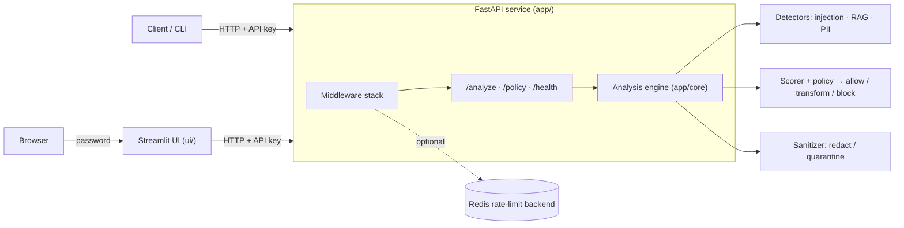

# Release Baseline — SentraGuard Lite v1.2.0

| | |
|---|---|
| **Status** | Proposed for maintainer approval. Sections marked **(recommendation)** are policy proposals, not existing project policy |
| **Date** | 2026-11-03 |
| **Principle** | **v1.2.0 is the stable baseline. Maintenance releases preserve compatibility wherever practical; larger architectural and user-facing changes are evaluated for v1.3.0.** |
| **Related** | [Post-release audit](post-release-audit-v1.2.0.md) · [v1.3.0 roadmap](roadmap-v1.3.0.md) · [Release & maintenance policy](release-and-maintenance-policy.md) · [Release checklist](release-checklist.md) |

## Table of contents

1. [Release identity and contents](#1-release-identity-and-contents)
2. [Architecture](#2-architecture)
3. [Supported configuration and integration points](#3-supported-configuration-and-integration-points)
4. [Validation procedures](#4-validation-procedures)
5. [Dependencies and runtime requirements](#5-dependencies-and-runtime-requirements)
6. [Known limitations and residual risks](#6-known-limitations-and-residual-risks)
7. [Backup, recovery and rollback assumptions](#7-backup-recovery-and-rollback-assumptions)
8. [Compatibility contract for the v1.2.x line](#8-compatibility-contract-for-the-v12x-line)
9. [Change control](#9-change-control)

Evidence tags used here: **[V]** verified in the release ZIP, **[X]** executed in the audit, **[N]** needs GitHub/runtime access. Details and the full evidence log are in the [audit](post-release-audit-v1.2.0.md#evidence-legend).

---

## 1. Release identity and contents

### 1.1 Identity

| Attribute | Value | Evidence |
|---|---|---|
| Product | SentraGuard Lite / Guardrails Gateway | [V] |
| Version | `1.2.0` (`API_VERSION` in `app/config.py`, heading in `CHANGELOG.md`) | [V] |
| Expected commit | `cc31374947395873fa8c43d8dfe0e206027e78ce` | reported by the pre-release audit [H] |
| Commit named in the ZIP archive comment | `cc31374947395873fa8c43d8dfe0e206027e78ce` (match) | [X] |
| Tag and GitHub Release | `v1.2.0` | **[N]** not provable from a ZIP; verify with the commands in the [audit §3](post-release-audit-v1.2.0.md#3-release-identity-and-provenance) |
| License | MIT | [V] |

The baseline is *defined* as the tree of that commit. (The tag-to-commit mapping was confirmed on 2026-11-16 under audit action A-13).

### 1.2 Supported deployment model

| Model | Status |
|---|---|
| **Docker Compose** with two services (`api` on 8000, `ui` on 8501), ports bound to loopback by default | **Supported, primary** |
| Single API container behind a TLS-terminating reverse proxy configured through `GUARDRAILS_TRUSTED_PROXIES` | Supported; the operator provides the proxy |
| Local development (`uvicorn app.main:app`, `streamlit run ui/streamlit_app.py`) | Supported for development; anonymous mode is allowed by default in code |
| Multiple API replicas / workers | **Not a tested topology.** The default rate limiter is per process; the Redis backend exists but is untested against a real server (BASE-015) |
| Kubernetes / orchestrators | Possible (stateless, `/health` probe), not documented or tested |

### 1.3 Contents of the release

90 files [V]:

| Category | Files | Notes |
|---|---:|---|
| Application source (`app/`) | 18 | 3 packages: `app`, `app.core`, `app.utils` |
| UI (`ui/`) | 2 | `streamlit_app.py`, `ui_helpers.py` |
| CLI | 1 | `cli.py` |
| Tests (`tests/`) | 36 | 34 test modules, `conftest.py`, `__init__.py`; 713 collected cases (707 + 6 E2E) |
| CI workflows (`.github/workflows/`) | 3 | `ci.yml`, `security.yml`, `codeql.yml` |
| GitHub config and security policy | 2 | `.github/SECURITY.md`, `.github/dependabot.yml` |
| Container and Compose | 3 | `Dockerfile.api`, `Dockerfile.ui`, `docker-compose.yml` |
| Dependency manifests | 4 | `requirements.{api,dev,ui,redis}.txt` — direct pins only, **no lockfile** |
| Documentation (Markdown) | 9 | README, CHANGELOG, CONTRIBUTING, `docs/` ×6 |
| Documentation images | 6 | Not referenced by any document (BASE-018) |
| Repository metadata and templates | 6 | `LICENSE`, `.env.example`, `.gitignore`, `.gitattributes`, `.dockerignore`, `pytest.ini` |

**Absent, normally expected:** `pyproject.toml`/packaging metadata, a lockfile, PR and issue templates, `CODEOWNERS`, a threat model, release automation, an SBOM. **Not present, correctly:** `.env`, virtual environments, caches, credentials [X].

---

## 2. Architecture

### 2.1 Components



| Component | Module(s) | Responsibility |
|---|---|---|
| HTTP application | `app/main.py` | Routes, middleware assembly, exception handler, lifespan startup validation |
| Configuration | `app/config.py` | All `GUARDRAILS_*` settings; strict parsing; import-time validation |
| Schemas | `app/schemas.py` | Request/response models and limits (prompt, documents, identifiers) |
| Analysis engine | `app/core/analyzer.py` | `evaluate()`: shared `ScanBudget`, prompt/document scanning, decision, quarantine |
| Detection | `app/core/detectors.py`, `app/utils/{text,regex,validators}.py` | Rule-based injection, RAG-injection and PII detection on normalized text |
| Policy and scoring | `app/core/policy.py`, `scorer.py` | Rule catalogue, severities, thresholds (`transform ≥ 40`, `block ≥ 80`), limits |
| Sanitization | `app/core/sanitizer.py` | Span-based redaction; helper functions |
| Authentication | `app/core/auth.py` | Single shared API key; public-path rules; startup validation |
| Rate limiting | `app/core/rate_limiter.py` | Sliding-window limiters (in-memory; optional Redis); client identity and proxy handling |
| Logging | `app/core/logger.py` | Stdout logging; value sanitization for log lines |
| UI | `ui/streamlit_app.py`, `ui_helpers.py` | Operator console; password gate; API client |
| CLI | `cli.py` | Command-line client |

### 2.2 Request flow

`POST /analyze` passes the middleware layers **outermost first** (declared in `app.main.MIDDLEWARE`; the order is asserted by a test [V]):

1. **assign_request_id** — accepts a well-formed inbound `X-Request-ID` (`[A-Za-z0-9._:-]{1,64}`), otherwise generates one; echoes it on every response.
2. **add_security_headers** — `X-Content-Type-Options: nosniff`, `X-Frame-Options: DENY`, `Referrer-Policy: no-referrer`, `Cache-Control: no-store` [X].
3. **enforce_authentication** — public paths bypass; otherwise `X-API-Key` or `Authorization: Bearer`, compared in constant time as UTF-8 bytes. A failure is counted in a **separate failed-auth limiter** and answered `401` (or `429`). Fails closed (`500`) if the key is required but missing.
4. **enforce_rate_limit** — per client key (IPv4 address; IPv6 collapsed to `/64`); `/health` is exempt; `429` + `Retry-After`.
5. **enforce_request_body_size** — `Content-Length` check plus a streaming cap (default 1 MiB) → `400`/`413`.

Then FastAPI validates the body (prompt ≤ 20,000 characters; ≤ 20 documents of ≤ 50,000 characters; identifiers ≤ 128 characters, no control characters; unique document ids) and calls `analyze_request` → `evaluate()`:

- One `ScanBudget` (default 20,000 findings) is shared by every detector call for the request. Detectors stop generating findings when it is spent.
- Prompt: injection rules, then PII. Documents: RAG/injection rules, then PII. A document containing a *quarantine*-action rule hit is dropped whole; PII and role markers are redacted.
- **Fail closed:** if the budget is exhausted the decision is `block`, an incompletely scanned prompt is replaced by the placeholder `[BLOCKED: prompt could not be fully scanned]`, an incompletely scanned document is quarantined whole, and later documents are quarantined unscanned.
- Output: `decision`, `risk_score`, `risk_tags`, `sanitized_prompt`, `sanitized_context_docs`, `quarantined_doc_ids`, `reasons[]`, `policy_version`.

### 2.3 Authentication and authorization boundaries

- **One trust level.** A single static API key grants full access to the API. There are no users, roles, scopes or tenants; no per-client revocation.
- **Public paths (default):** `/health`, `/docs`, `/redoc`, `/openapi.json` (override: `GUARDRAILS_PUBLIC_PATHS`). `/policy` and `/analyze` require the key when authentication is enabled.
- **Authentication is enabled** when `GUARDRAILS_API_KEY` is set or `GUARDRAILS_REQUIRE_AUTH=true`. In code the default permits anonymous operation (local development) with a startup warning; the Docker image and Compose file default to refusing to start without a key.
- **UI boundary.** The UI holds the API key and lends it to whoever passes its gate: locked unless `GUARDRAILS_UI_PASSWORD` is set (or anonymous use is explicitly allowed). The gate is a single shared password with a per-session delay only (BASE-007).
- **TLS** is not terminated by the application; use a reverse proxy.

### 2.4 Configuration sources

Environment variables only (18 read by `app/config.py`, plus UI/CLI/Compose variables). Parsing is strict: an unrecognized value stops startup. **`.env` is read only by Docker Compose** for variable substitution; neither `uvicorn` nor `streamlit` loads it [V]. Unknown `GUARDRAILS_*` names are silently ignored (BASE-005). Reference: [`docs/configuration.md`](configuration.md) (verified accurate for defaults).

### 2.5 Storage and persistence

**None.** No database, queue, volume, cache or background job [V]. Rate-limit counters live in process memory (bounded to 50,000 clients with an overflow bucket) unless the optional Redis backend is selected.

### 2.6 External services and integrations

None required. Optional: Redis (rate limiting). No outbound calls are made by the analysis path; no third-party model APIs [V]. HTTP clients are the CLI and UI, which call the API.

### 2.7 Deployment topology

```text
 host (127.0.0.1 by default)
  ├─ :8000 ─► [api container]  read-only root fs · tmpfs /tmp · cap_drop ALL · no-new-privileges
  │                             512 MiB · 1 CPU · 128 PIDs · UID 10001 · healthcheck /health
  └─ :8501 ─► [ui container]   read-only root fs · tmpfs /tmp,~/.streamlit,~/.cache · same hardening
                               256 PIDs · depends_on api (service_healthy) · calls http://api:8000
```

### 2.8 Logging, monitoring and error handling

- Logs to stdout, one line per event: `timestamp | LEVEL | message`; analysis results as a JSON message (`event: analysis_completed` with `request_id`, `app_id`, `decision`, `risk_score`, rule ids). Prompt and document text are never logged [V]; attacker-controlled values are escaped and truncated.
- Unhandled exceptions return `{"detail": "Internal Server Error"}` with a request ID; the app logs the exception **type** and request ID only.
- No metrics endpoint, no readiness endpoint distinct from `/health`, no access log with status and duration (roadmap V13-004, V13-013).

---

## 3. Supported configuration and integration points

These are the interfaces v1.2.x treats as **public** (see §8).

**HTTP API**

| Endpoint | Auth | Notes |
|---|---|---|
| `POST /analyze` | required when auth enabled | Body: `prompt`, `context_docs[]`, `metadata{app_id,user_id,request_id}` |
| `GET /policy` | required when auth enabled | Rule catalogue, thresholds, limits, `incomplete_scan_prompt` |
| `GET /health` | public, rate-limit exempt | `{"status":"ok"}` |
| `/docs`, `/redoc`, `/openapi.json` | public by default | Provided by FastAPI |

Status codes: `200, 400, 401, 413, 422, 429 (+Retry-After), 500`. Response header `X-Request-ID` on every response.

**Environment** — the 18 variables in [`docs/configuration.md`](configuration.md); UI variables `API_URL`, `GUARDRAILS_API_KEY`, `GUARDRAILS_UI_PASSWORD`, `GUARDRAILS_UI_ALLOW_ANONYMOUS`; CLI variable `GUARDRAILS_API_URL`; Compose variable `GUARDRAILS_BIND_ADDRESS`.

**CLI** — `python cli.py --prompt … [--doc …] [--api-url …] [--api-key …]`.

**Integration pattern** — callers must use `sanitized_prompt` / `sanitized_context_docs` whenever `decision != "allow"` and must refuse the request when `decision == "block"`.

---

## 4. Validation procedures

| Procedure | Command | Baseline result |
|---|---|---|
| Unit and integration tests | `python -m pytest -m "not e2e" --cov=app --cov-report=term-missing --cov-fail-under=95` | 707 passed, 6 deselected, 100.00 % of 904 statements **[X]** (Python 3.12, approximate environment) |
| Browser E2E | `python -m pytest -m e2e tests/test_ui_e2e.py -v` after `pip install playwright pytest-playwright` and `playwright install chromium` | 6 cases; reported passing in CI **[H]**; **NOT EXECUTED** in the audit |
| Static security analysis | `bandit -r app cli.py -ll` (CI scope; `ui/` is not scanned) | **No findings [X]** (Bandit 1.9.4); also clean when `ui/` is added |
| Dependency audit | `pip-audit --desc -r requirements.api.txt -r requirements.dev.txt`, then `-r requirements.ui.txt`, `-r requirements.redis.txt` | Reported clean **[H]**; **NOT EXECUTED** in the audit |
| Secret scan | TruffleHog (`--only-verified`) in CI | Reported clean **[H]**; audit pattern scan found no secrets **[X]** |
| CodeQL | `.github/workflows/codeql.yml` | Reported clean **[H]** |
| CI matrix | Python 3.11 and 3.14 (unit); 3.11 (E2E) | Reported passing **[H]** |

CI results can only be confirmed on GitHub **[N]**. See the [release checklist](release-checklist.md) for the full pre- and post-release gates.

---

## 5. Dependencies and runtime requirements

| Item | Value |
|---|---|
| Runtime | Python 3.11 (image: `python:3.11-slim`, floating tag); CI also tests 3.14 |
| API runtime pins | `fastapi==0.139.2`, `starlette==1.3.1`, `pydantic==2.13.4`, `uvicorn==0.51.0` |
| UI pins | `streamlit==1.66.1`, `Pillow==13.0.0`, `requests==2.34.2` |
| Dev/test | `pytest==9.1.1`, `httpx2==2.15.1`, `pytest-cov` (unpinned); Playwright (installed unpinned in CI) |
| Optional | `redis>=5.0,<8.0` (range, not installed in the image) |
| Not pinned | Transitive dependencies; no lockfile or hashes (BASE-010) |
| Container resources | 512 MiB RAM, 1 CPU, 128/256 PIDs per service (Compose defaults) |

---

## 6. Known limitations and residual risks

Authoritative list with evidence: the [audit](post-release-audit-v1.2.0.md). The baseline carries these forward as **known and accepted until addressed**:

| # | Limitation | Reference |
|---|---|---|
| L1 | **Regex CPU time is not bounded.** The finding budget bounds findings and per-match work, not scanning of text that has no matches. Python's `re` cannot be interrupted. ≈ 1.0–1.3 s CPU per maximum-size request [X] | audit §10 |
| L2 | **Scan length after normalization is unbounded** (NFKC expansion up to 18×): 878 KiB can cost 7.1 s and +58 MB and is allowed | BASE-002 |
| L3 | **Oversized base64 tokens (> 5,336 chars) are not decoded**, so padding evades the encoded-payload rule (reclassified High severity per SECURITY.md; v1.2.1 priority) | BASE-001 |
| L4 | **Detection is pattern-based**; recall on paraphrase, other languages, and unlisted encodings is low and unmeasured | audit §10 |
| L5 | **One shared API key**: no rotation window, revocation or attribution | roadmap V13-006 |
| L6 | **Per-process rate limiter**; Redis backend untested against a real server | BASE-015 |
| L7 | **UI password gate** is basic (BASE-007); the UI must not be exposed without an authenticating proxy | BASE-007 |
| L8 | **No TLS, no HSTS, no CSP** from the application; use a reverse proxy | BASE-003 |
| L9 | **Documentation drift**: several public documents describe controls the code does not implement | audit §8 |
| L10 | Containers are verified by static inspection only; no CI build/run/scan | BASE-011 |

---

## 7. Backup, recovery and rollback assumptions

- **No application state exists**, so there is nothing to back up or restore except the **operator-managed secrets and `.env`** (API key, UI password, proxy list). Keep them in a secret store, not in the repository.
- **Recovery** = redeploy a known-good tag with the same environment. Expect a short restart gap on a single-container deployment; in-memory rate-limit counters reset.
- **Rollback** = deploy the previous release tag (`git checkout <tag>` and rebuild). **Do not delete or move a published tag.** Images are built locally; no registry is published, so "previous image" means "rebuild the previous tag".
- **Compatibility on rollback:** environment variables introduced in v1.2.0 are ignored by older releases; a rollback to v1.1.x loses the v1.2.0 security hardening and should be a last resort (record the reason in the incident notes).
- **Upgrade:** within v1.2.x, replace the code and restart; configuration is unchanged by contract (§8). Run the pre-flight in the [checklist](release-checklist.md) — note that `import app.main` does **not** validate authentication settings; start the application instead.

---

## 8. Compatibility contract for the v1.2.x line

**(recommendation — requires maintainer approval)**

**Preserved for the whole v1.2.x line** (a change requires v1.3.0 or v2.0.0, see the [policy](release-and-maintenance-policy.md)):

1. HTTP paths, methods, request fields and limits, response fields and types, status codes.
2. Decision values (`allow`, `transform`, `block`), `risk_tags` values, and **rule identifiers** returned in `reasons[].rule` (including `scan_limit_exceeded` and the `encoded:` prefix).
3. The text of `incomplete_scan_prompt` in `GET /policy`, and the `BLOCK`/`TRANSFORM` thresholds.
4. Names, types, defaults and strict-parsing behavior of all documented environment variables; **defaults of security settings** (for example `GUARDRAILS_ALLOW_ANONYMOUS`).
5. Compose service names, ports, health endpoint, container user, and the hardening settings.
6. `X-Request-ID` behavior and the four security headers currently sent.
7. CLI flags.

**May change in a patch (v1.2.x)** when the change is a fix, not a redefinition:

- Detector fixes that **increase** detection of known-bad input (bypass fixes), or decrease false positives of benign input — recorded under *Security* or *Fixed* in the changelog.
- New *rejections* of pathological input only when thresholds cannot affect realistic input (for example BASE-002's cap).
- Documentation, CI, test and dependency-patch updates; log message wording; new log fields.

**Exceptions.** Security fixes may break compatibility when no compatible fix exists; the changelog must say so prominently and the maintainer should consider an advisory.

**Not promised:** byte-exact responses for pathological inputs, log line formats, the in-memory limiter's internal behavior, or support for the Redis backend until it is verified (BASE-015).

---

## 9. Change control

- Changes to anything in §8's first list require a **minor** or **major** release.
- A bug found in v1.2.0 is fixed in v1.2.x only if the fix preserves §8; otherwise it is scheduled for v1.3.0 and, if security-relevant, documented with a mitigation in the meantime.
- Every release (patch or minor) updates `CHANGELOG.md`, `API_VERSION`, and — if behavior changed — the affected documents, and passes the [release checklist](release-checklist.md).
- This baseline document is updated only when the baseline itself changes (for example to point to the first v1.3.0 baseline); corrections to *this* text are documentation-only changes.
