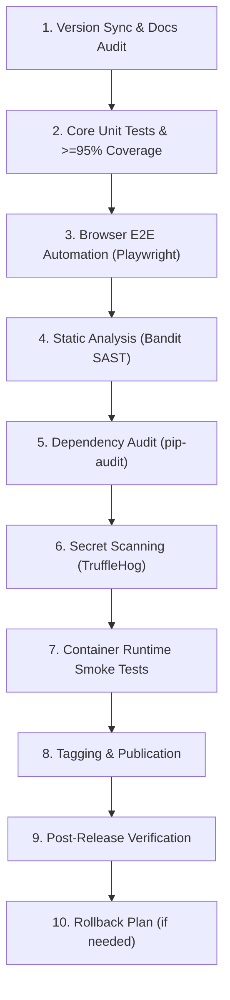

# Release Readiness Checklist & Verification Gates

This checklist defines the mandatory pre-release gates and operational verification steps required before tagging and publishing a new release of SentraGuard Lite, and the verification required **after** publication. It applies to patch releases (v1.2.x) and minor releases; see the [release and maintenance policy](release-and-maintenance-policy.md) for what each release type may contain.

> **Revision status:** extended and corrected relative to the version shipped in v1.2.0. Changes are listed in [Revision notes](#revision-notes). Commands marked *(unverified)* were drafted but not executed when this revision was written; run them once and correct this file if needed.

---

## Pre-Release Gate Matrix

All checklist gates must be marked verified prior to publishing a Git tag. Gate 9 is completed after publication.



**Rules for every gate:** record the exact command, environment (OS, Python version) and result. A gate that was not executed is recorded as `NOT EXECUTED`, never as passed. CI results count only when linked to a run on the release commit.

---

## 1. Version Synchronization & Documentation

- [ ] **Version sync**: `API_VERSION` in `app/config.py` equals the newest (non-`Unreleased`) heading in `CHANGELOG.md`:

  ```bash
  python - <<'PY'
  import pathlib, re
  code = re.search(r'API_VERSION = "([^"]+)"', pathlib.Path("app/config.py").read_text()).group(1)
  head = re.search(r"^## (?!Unreleased)(\S+)", pathlib.Path("CHANGELOG.md").read_text(), re.M).group(1)
  print("API_VERSION =", code, "| newest changelog heading =", head)
  raise SystemExit(0 if code == head else "version mismatch")
  PY
  ```

- [ ] **No stale version strings**: `grep -rn "<previous version>" README.md docs/ .github/ CONTRIBUTING.md` returns only intentional historical references.
- [ ] **Changelog Integrity**: `CHANGELOG.md` has an entry for the release version in [Keep a Changelog](https://keepachangelog.com/en/1.0.0/) style, with `Security`, `Fixed`, `Added`, `Changed` and, for minor/major releases, `Breaking changes`. The entry contains **only implemented, merged changes**, and published entries of earlier versions are unmodified.
- [ ] **Compatibility statement**: the changelog entry states whether the [compatibility contract](release-baseline-v1.2.0.md#8-compatibility-contract-for-the-v12x-line) is preserved; any exception is called out.
- [ ] **README Accuracy**: `README.md` reflects current architecture and quick start.
- [ ] **Configuration Documentation**: `docs/configuration.md` lists exactly the variables read by `app/config.py` with correct defaults. No document mentions a variable that no code reads.
- [ ] **API Documentation**: `docs/api.md` matches the real endpoints, status codes and **response headers** (verify against a running instance: `curl -si http://127.0.0.1:8000/health` — compare the header list with every document that lists headers).
- [ ] **Quoted literals**: strings quoted in documents (health payload `{"status":"ok"}`, the `incomplete_scan_prompt` text, header values) equal the values returned by the application (`GET /policy`).
- [ ] **Security Policy**: `.github/SECURITY.md` lists supported versions correctly, contains only controls that exist, and gives realistic response timelines.

---

## 2. Test Suite & Coverage Thresholds

```bash
python -m pytest -m "not e2e" --cov=app --cov-report=term-missing --cov-fail-under=95 -v
```

- [ ] **Zero Failures**: all unit, integration and security regression tests pass on **each Python version in the CI matrix** (currently 3.11 and 3.14).
- [ ] **Coverage Threshold**: total coverage of `app/` is **>= 95 %**. Coverage is a gate, not proof of correctness.
- [ ] **Regression proof** (patch releases): each fix has a test that fails when the fix is reverted.
- [ ] **State Isolation**: the rate-limiter reset fixture in `tests/conftest.py` runs without cross-test leakage (the suite also passes when modules run in a different order).

---

## 3. Browser End-to-End Automation

Install the browser tooling (not in `requirements.dev.txt`), then run the Playwright tests against the Streamlit UI:

```bash
pip install playwright pytest-playwright
playwright install chromium
python -m pytest -m e2e tests/test_ui_e2e.py -v
```

- [ ] **All 6 E2E cases pass** (CI also asserts the count `6 passed`; update that check when tests are added).
- [ ] **Access Gate**: unauthenticated users see the locked authentication screen.
- [ ] **Authentication Flow**: wrong password rejected; valid password unlocks the dashboard.
- [ ] **DOM Hygiene**: credentials do not appear in the rendered DOM.

---

## 4. Static Application Security Testing (SAST)

```bash
bandit -r app ui cli.py -ll
```

- [ ] **Zero High/Medium Findings** across `app/`, `ui/` and `cli.py` (verified clean on v1.2.0, Bandit 1.9.4).
- [ ] **Suppressions Documented**: every `# nosec` has a justification and maintainer approval.
- [ ] **CodeQL**: the `CodeQL (Python)` check is green on the release commit.

---

## 5. Dependency Vulnerability Audits

Audit **every** requirements file (this mirrors `.github/workflows/security.yml`; run the commands separately, as CI does):

```bash
pip-audit --desc -r requirements.api.txt -r requirements.dev.txt
pip-audit --desc -r requirements.ui.txt
pip-audit --desc -r requirements.redis.txt
```

- [ ] **Zero Unpatched Vulnerabilities** in all four sets, or each exception is documented with a justification and an expiry.
- [ ] **Resolvability**: the pinned sets install cleanly on every Python version in the CI matrix. *(There is no lockfile today; see roadmap V13-008. Do not claim lockfile consistency.)*
- [ ] **New or changed pins reviewed** in the diff (name, version, source).

---

## 6. Secret Detection & History Scans

```bash
trufflehog git file://. --only-verified
```

- [ ] **TruffleHog Clean**: no verified secrets in git history or the working tree. (`--only-verified` reports only *verified* secrets; also skim the unverified output once per release.)
- [ ] **CI secret scan green** on the release commit (push and the scheduled full-history run).
- [ ] **Codebase Inspection**: no un-redacted passwords, keys or tokens; `.env` is not tracked or packaged.
- [ ] **External scanners** (for example GitGuardian): if the repository uses one, historical findings are resolved; otherwise mark this item *not applicable*.

---

## 7. Container Build & Runtime Hardening Verification

The shipped images are verified by *running* them, not only by inspecting files. *(Steps 3–7 are unverified drafts — see the revision status above.)*

```bash
# 1. Static hardening tests
python -m pytest tests/test_deployment_hardening.py -v

# 2. Build both images
docker compose build

# 3. Create a temporary environment file with generated secrets (never commit it)
cp .env.example .env
python - <<'PY'
import pathlib, re, secrets
p = pathlib.Path(".env"); t = p.read_text()
t = re.sub(r"^GUARDRAILS_API_KEY=.*$", "GUARDRAILS_API_KEY=" + secrets.token_urlsafe(32), t, flags=re.M)
t = re.sub(r"^GUARDRAILS_UI_PASSWORD=.*$", "GUARDRAILS_UI_PASSWORD=" + secrets.token_urlsafe(16), t, flags=re.M)
p.write_text(t)
PY

# 4. Start the stack and wait until both services are healthy
docker compose up -d --wait

# 5. Probe the API (the key is read from .env; do not print it)
curl -fsS http://127.0.0.1:8000/health                     # expect {"status":"ok"}
curl -s -o /dev/null -w "%{http_code}\n" -X POST http://127.0.0.1:8000/analyze \
     -H "Content-Type: application/json" -d '{}'            # expect 401 (no key)

# 6. Inspect the running containers
docker inspect -f '{{.Config.User}} {{.HostConfig.ReadonlyRootfs}} {{.HostConfig.CapDrop}} {{.HostConfig.Memory}}' sentraguard-api sentraguard-ui
docker compose port api 8000                                # expect 127.0.0.1:8000

# 7. Tear down and remove the temporary secrets
docker compose down -v
rm -f .env
```

- [ ] **Both services reach `healthy`** (`docker compose up -d --wait` succeeds).
- [ ] **Hardened Runtime Configuration** confirmed on the running containers:
  - Read-only root filesystem (`ReadonlyRootfs` = `true`).
  - Non-root user (`appuser`, UID/GID `10001:10001`).
  - Capabilities dropped (`[ALL]`), `no-new-privileges` set.
  - Memory limit `512m` (= 536870912 bytes) and one CPU enforced; `pids_limit` 128 (API) / 256 (UI).
  - Published ports bind to `127.0.0.1` by default.
- [ ] **Health Probe**: `GET /health` returns `200` with `{"status":"ok"}`.
- [ ] **Fail-closed start**: with `GUARDRAILS_API_KEY` empty and `GUARDRAILS_ALLOW_ANONYMOUS` unset, `docker compose up api` exits with the "No GUARDRAILS_API_KEY is configured" error. *(Note: `python -c "import app.main"` does **not** test this — authentication is validated at application startup, not at import.)*
- [ ] **UI gate**: with a key but no `GUARDRAILS_UI_PASSWORD`, the UI shows the "locked" message.

---

## 8. Release Tagging & Publication Runbook

Once gates 1–7 are verified. Tags are **annotated**, target an **explicit commit**, and are never moved or reused once published ([policy §6](release-and-maintenance-policy.md#6-release-and-tag-policy)).

```bash
VERSION=X.Y.Z                       # e.g. 1.2.1
SHA=$(git rev-parse origin/main)    # the exact commit that passed the gates; confirm it equals the CI run you checked

# 1. The release commit is on main, the working tree is clean, CI is green for $SHA
git fetch origin --tags
git status --short                  # expect no output

# 2. Create an annotated tag on that commit (use -s instead of -a if a signing key is configured)
git tag -a "v$VERSION" "$SHA" -m "SentraGuard Lite v$VERSION"

# 3. Verify BEFORE pushing
git cat-file -t "v$VERSION"                      # expect: tag
git rev-parse "v$VERSION^{commit}"               # expect: $SHA

# 4. Push only the tag
git push origin "v$VERSION"

# 5. Prepare release notes from the changelog and create a DRAFT release
awk -v v="$VERSION" '$0 == "## " v {f=1; next} /^## / && f {exit} f' CHANGELOG.md > release-notes.md
test -s release-notes.md || { echo "no changelog section for $VERSION"; exit 1; }
# GitHub: create a draft release for tag v$VERSION with release-notes.md, review it, then publish.
```

- [ ] Tag is annotated (or signed) and points at the verified commit.
- [ ] Release notes equal the changelog section; "Upgrade notes" added if behavior changed.
- [ ] Release published (not left as draft) and, for release candidates only, marked as a pre-release.

---

## 9. Post-Release Verification

Complete within one working day of publishing.

- [ ] **Tag integrity**: on a fresh clone, `git rev-parse v$VERSION^{commit}` equals the intended commit; `git cat-file -t v$VERSION` is `tag`.
- [ ] **Release metadata**: the release's tag, target and notes are correct, and it is not a draft or pre-release (`gh release view v$VERSION --json tagName,targetCommitish,isDraft,isPrerelease`).
- [ ] **Source archive provenance**: download the release ZIP, read its comment with `unzip -z` (must be the release commit), then extract it and `diff -r` against `git archive v$VERSION` extracted. Do not compare raw archive bytes (GitHub does not guarantee byte-identical regeneration).
- [ ] **CI on the release commit** is green (link the runs: tests, E2E, Bandit, pip-audit, TruffleHog, CodeQL).
- [ ] **Clean-checkout smoke test**: check out the tag in a new directory and repeat Gate 7 steps 3–7.
- [ ] **Upgrade check** (minor/major, and patches that touch configuration): start from the previous release's `.env` without changes and confirm the service starts and `/health` is `ok`.
- [ ] **Documentation links**: the README and policy documents link to the new release notes where appropriate.
- [ ] **Monitor** new issues, security alerts and Dependabot/code-scanning alerts for several days; record the outcome.
- [ ] **Follow-ups logged**: open an issue for each deferred item; update the audit/action register.

---

## 10. Rollback Plan

If an unexpected regression is identified after release:

1. **Do not delete or move the tag.** Published tags and releases are immutable.
2. **Mark the release**: edit its notes with a clear warning and a link to the fix; mark it as a pre-release if it is dangerous. Publish an advisory if the problem is security-relevant.
3. **Fix forward**: publish the next patch release after the normal gates.
4. **Roll back a deployment** to the previous *tag* (images are built locally and are not published to a registry). The service is stateless, so no data restore is needed:

   ```bash
   docker compose down
   git fetch --tags
   git checkout vPREVIOUS             # a tag that exists; verify with: git tag --list
   docker compose up -d --build --wait
   curl -fsS http://127.0.0.1:8000/health
   ```

   Return to a branch afterwards (`git checkout main`). Rolling back across a security fix reintroduces the fixed weakness: record why, and treat it as temporary.
5. **Notify users** through the release notes, GitHub Discussions or a Security Advisory.

---

## Patch-release addendum (v1.2.x)

In addition to gates 1–10, a patch release requires:

- [ ] A recorded issue (or private advisory) with severity, affected versions and **compatibility impact** (policy §2.1).
- [ ] The smallest safe change, one concern per pull request.
- [ ] A regression test that fails without the fix.
- [ ] A backport decision for supported maintenance lines (policy §5, §7) when security-relevant.
- [ ] No new behavior: new settings, endpoints or fields are a **minor** release.

---

## Revision notes

Relative to the checklist shipped in v1.2.0:

| Area | Change |
|---|---|
| Gate 1 | Added version-sync check, stale-version search, compatibility statement, verification of quoted literals and header lists; removed the unverifiable "verified test counts" |
| Gate 2 | Per-Python-version requirement; regression-proof item |
| Gate 3 | Added the Playwright installation steps (not in `requirements.dev.txt`) and the 6-case expectation |
| Gate 4 | Bandit now covers `ui/` (verified clean); CodeQL item added |
| Gate 5 | Command now covers all four requirements files, mirroring CI (the old command omitted `requirements.redis.txt`); removed the claim of "lockfile consistency" — no lockfile exists |
| Gate 6 | Clarified `--only-verified`; made GitGuardian conditional (nothing in the repository configures it) |
| Gate 7 | The old gate built images but never started them before probing; it now starts the stack, probes, inspects the running containers and tears down; health payload corrected from `healthy` to `ok`; added fail-closed-start and UI-gate checks |
| Gate 8 | Tag now targets an explicit commit and is verified before pushing; "annotated signed" corrected (annotated ≠ signed); removed the stale `docs/v1.2-release-readiness` branch push and the no-op `git diff --check` on a clean tree; release notes extracted by script |
| Gate 9 | **New**: post-release verification |
| Gate 10 (was 9) | Rollback no longer says to "retract" the tag; clarifies images are not published and the service is stateless; warns about rolling back across a security fix |
| Addendum | **New**: patch-release requirements |
