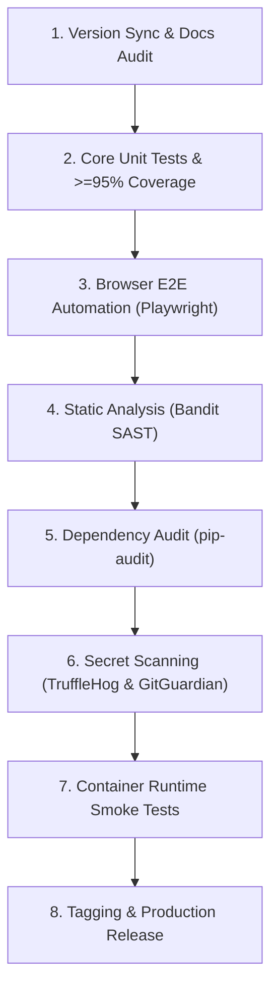

# Release Readiness Checklist & Verification Gates

This checklist defines the mandatory pre-release gates and operational verification steps required before tagging and publishing a new release of SentraGuard Lite.

---

## Pre-Release Gate Matrix

All checklist gates must be marked verified prior to cutting a release branch or publishing a Git tag.



---

## 1. Version Synchronization & Documentation

- [ ] **Changelog Integrity**: `CHANGELOG.md` contains an entry for the release version adhering to [Keep a Changelog](https://keepachangelog.com/en/1.0.0/) format, documenting all `Security`, `Added`, `Changed`, and `Fixed` items.
- [ ] **README Accuracy**: `README.md` reflects current architecture, quick start instructions, and verified test counts.
- [ ] **Configuration Documentation**: `docs/configuration.md` documents all active environment variables, default values, and types.
- [ ] **API Documentation**: `docs/api.md` aligns with current endpoint schemas, response codes, and security headers.
- [ ] **Security Policy**: `.github/SECURITY.md` confirms active support for the target version and accurate disclosure channels.

---

## 2. Test Suite & Coverage Thresholds

Run the primary automated test suite with coverage enforcement:

```bash
python -m pytest -m "not e2e" --cov=app --cov-report=term-missing --cov-fail-under=95 -v
```

- [ ] **Zero Failures**: All unit, integration, and security regression tests pass without errors.
- [ ] **Coverage Threshold**: Total test coverage across `app/` is **>= 95%**.
- [ ] **State Isolation**: Rate limiter reset fixture in `tests/conftest.py` executes without cross-test leakage.

---

## 3. Browser End-to-End Automation

Execute Playwright browser automation tests against the Streamlit administration UI:

```bash
pytest -m e2e tests/test_ui_e2e.py -v
```

- [ ] **Access Gate Verification**: Unauthenticated users encounter the locked authentication screen.
- [ ] **Authentication Flow**: Valid password unlocks the dashboard.
- [ ] **DOM Hygiene**: Credentials are not leaked in raw DOM text attributes.

---

## 4. Static Application Security Testing (SAST)

Run Bandit AST analysis across application source code:

```bash
bandit -r app cli.py -ll
```

- [ ] **Zero High/Medium Findings**: Bandit reports zero high or medium severity security issues.
- [ ] **Suppressions Documented**: Any `# nosec` annotations have documented justifications and maintainer approval.

---

## 5. Dependency Vulnerability Audits

Audit production and development dependencies against open-source vulnerability databases:

```bash
pip-audit -r requirements.api.txt -r requirements.ui.txt -r requirements.dev.txt
```

- [ ] **Zero Unpatched Vulnerabilities**: No known CVEs reported across required packages.
- [ ] **Lockfile Consistency**: Dependencies remain cleanly resolvable across Python 3.11–3.14.

---

## 6. Secret Detection & History Scans

Verify that no active or synthetic secrets enter git history:

```bash
trufflehog git file://. --only-verified
```

- [ ] **TruffleHog Clean**: Zero verified secrets detected in git history or working tree.
- [ ] **GitGuardian Status**: All historical findings (such as synthetic test credentials) are documented and marked as resolved in the dashboard.
- [ ] **Codebase Inspection**: Working tree contains no un-redacted passwords, keys, or tokens.

---

## 7. Container Build & Runtime Hardening Verification

Build local images and run deployment hardening verification:

```bash
# 1. Run deployment hardening test suite
pytest tests/test_deployment_hardening.py -v

# 2. Build local Docker images
docker compose build

# 3. Verify health probe
python -c "import urllib.request; print(urllib.request.urlopen('http://127.0.0.1:8000/health').status)"
```

- [ ] **Hardened Runtime Configuration**:
  - `read_only: true` on root filesystems.
  - Non-root execution (`USER appuser`, UID/GID `10001:10001`).
  - Kernel capabilities dropped (`cap_drop: [ALL]`).
  - Privilege escalation disabled (`no-new-privileges: true`).
  - Memory limit (`512m`) and CPU share (`1.0`) enforced.
  - Published ports bind to loopback (`127.0.0.1`) by default.
- [ ] **Health Probes**: `GET /health` returns `200 OK` with `{"status": "healthy"}`.

---

## 8. Release Tagging & Publication Runbook

Once all checklist items are verified:

```bash
# 1. Ensure working tree is clean
git status
git diff --check

# 2. Tag release with annotated signed tag
git tag -a v1.2.0 -m "Release v1.2.0: SentraGuard Lite hardening and release readiness"

# 3. Push release branch and tags to remote
git push origin docs/v1.2-release-readiness
git push origin v1.2.0

# 4. Create GitHub Release Draft
# Include CHANGELOG.md section for v1.2.0
```

---

## 9. Rollback Plan

If an unexpected regression is identified post-release:
1. **Revert Tag**: Retract or mark the GitHub Release as pre-release / deprecated.
2. **Container Rollback**: Redeploy the previous stable container image (`v1.1.0`):
   ```bash
   docker compose down
   git checkout v1.1.0
   docker compose up -d --build
   ```
3. **Notify Users**: Post a status advisory on GitHub Discussions or Security Advisories.
