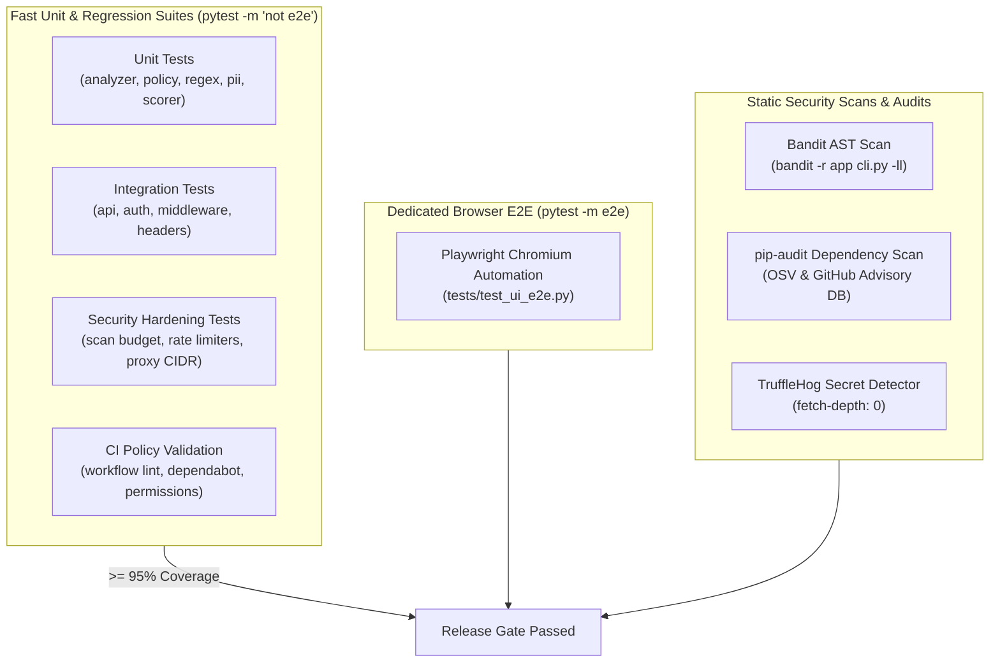

# Testing & Verification Guide

This guide details the testing architecture, test suites, coverage requirements, browser end-to-end automation, and automated security scanning tools used in SentraGuard Lite v1.2.

---

## 1. Test Architecture Overview

SentraGuard Lite enforces a rigorous multi-tier testing strategy combining fast unit tests, comprehensive security regression suites, integration tests, end-to-end browser automation, and static application security testing (SAST).



---

## 2. Running Unit & Integration Tests

### Standard Test Execution
To run all unit, integration, and security regression tests while verifying coverage:

```powershell
# PowerShell
python -m pytest -m "not e2e" --cov=app --cov-report=term-missing --cov-fail-under=95 -v
```

```bash
# Linux / macOS
python -m pytest -m "not e2e" --cov=app --cov-report=term-missing --cov-fail-under=95 -v
```

### Key Pytest Options
- `-m "not e2e"`: Filters out browser-based UI automation tests, allowing the suite to run in headless environments without requiring Chromium binaries.
- `--cov=app`: Measures test coverage across all modules inside `app/`.
- `--cov-fail-under=95`: Fails the test execution if total coverage falls below **95%**.
- `--cov-report=term-missing`: Prints exact un-covered line numbers for quick identification during development.

### State Isolation & Fixtures (`tests/conftest.py`)
The rate limiter engine in `app/core/rate_limiter.py` maintains state across requests. To prevent cross-test contamination:
- `tests/conftest.py` defines an `autouse=True` fixture that automatically resets the global in-memory rate limiter singleton before and after every test execution.
- If writing tests that modify environment variables (`os.environ`), always use pytest's `monkeypatch` fixture to guarantee automatic cleanup.

---

## 3. Browser End-to-End Testing (Playwright)

End-to-end user experience and access-gating tests for the Streamlit administration UI are implemented in `tests/test_ui_e2e.py` using Microsoft Playwright.

### Installing Playwright Dependencies

To run browser E2E tests locally:

```bash
# 1. Install playwright python package
pip install playwright

# 2. Download Chromium browser binaries and system dependencies
playwright install --with-deps chromium
```

### Running E2E Browser Tests

```bash
pytest -m e2e tests/test_ui_e2e.py -v
```

### What E2E Tests Validate
1. **Access Gating**: Confirms that when `GUARDRAILS_UI_PASSWORD` is configured, unauthenticated visitors are presented with a locked authentication prompt.
2. **Session Authentication**: Validates password entry and successful unlocking of the dashboard.
3. **DOM Credential Hygiene**: Verifies that the API key and password inputs are rendered with `type="password"` and not leaked in raw DOM text attributes.
4. **Interactive Analysis**: Simulates entering a prompt, triggering scan analysis, and rendering detection findings.

---

## 4. Security Audits & Static Analysis

Before submitting pull requests or packaging a release, run the security audit tools configured in our CI pipeline:

### 1. Bandit AST Analysis
Bandit inspects Python AST trees for security flaws, insecure function calls, and weak cryptography:

```bash
bandit -r app cli.py -ll
```
*Note: `-ll` filters findings to medium and high severity.*

### 2. Dependency Vulnerability Audit (`pip-audit`)
Audits installed packages and requirements files against known CVEs:

```bash
pip-audit -r requirements.api.txt -r requirements.ui.txt -r requirements.dev.txt
```

### 3. Secret Detection (`TruffleHog`)
Scans git commits for accidental API key or credential commits:

```bash
trufflehog git file://. --only-verified
```

---

## 5. CI Workflow & Policy Verification

The repository includes automated meta-tests that validate GitHub Actions workflow configurations, permissions, and security policies:

```bash
pytest tests/test_ci_workflows.py tests/test_ci_security_policy.py -v
```

### What CI Policy Tests Assert:
- All required workflow files exist (`ci.yml`, `security.yml`, `codeql.yml`, `dependabot.yml`).
- Workflows specify least-privilege permissions (`contents: read`).
- Third-party GitHub Actions are pinned to full 40-character commit SHAs.
- Dependabot monitors GitHub Actions, pip dependencies, and Docker base images.
- `.github/SECURITY.md` exists and contains mandatory disclosure guidelines, SLA terms, and scanner references.
