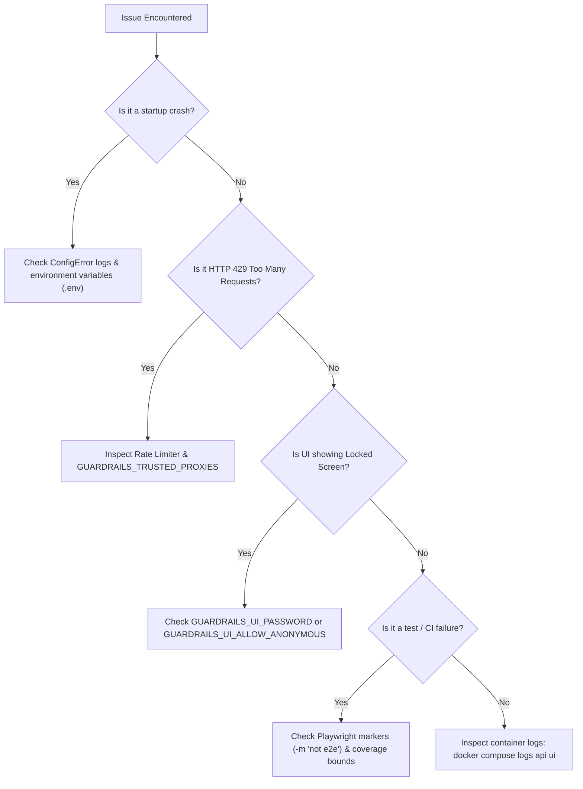

# Troubleshooting & Diagnostics Runbook

This guide provides diagnosis steps, root cause analysis, and proven solutions for common development, deployment, and operational failure modes in SentraGuard Lite v1.2.

---

## Quick Diagnostic Checklist

When encountering an unexpected failure, execute these checks in order:



---

## 1. Startup Failures & Configuration Errors

### Symptom: `app.config.ConfigError: GUARDRAILS_API_KEY must not be empty`
- **Root Cause**: The gateway refuses to start anonymously unless explicitly configured to allow it.
- **Resolution**:
  - In development, populate `GUARDRAILS_API_KEY` in your `.env` file:
    ```bash
    GUARDRAILS_API_KEY=dev-secret-key-12345
    ```
  - If you intentionally want unauthenticated access for local development:
    ```bash
    GUARDRAILS_ALLOW_ANONYMOUS=true
    ```
  - *Warning: Never enable `GUARDRAILS_ALLOW_ANONYMOUS=true` in production.*

### Symptom: `app.config.ConfigError: Invalid numeric value for GUARDRAILS_...`
- **Root Cause**: An environment variable expecting an integer (e.g. `GUARDRAILS_RATE_LIMIT_REQUESTS=not-a-number`) received invalid non-numeric text.
- **Resolution**: Ensure all integer environment variables contain valid digits only (e.g. `60`, `1048576`).

---

## 2. Port Binding Conflicts

### Symptom: `OSError: [Errno 98] Address already in use: 8000` or `bind: address already in use: 8501`
- **Root Cause**: Another local process or an existing Docker container is already bound to port 8000 (API) or 8501 (UI).
- **Resolution**:
  1. Identify the process occupying the port:
     ```powershell
     # Windows (PowerShell)
     Get-NetTCPConnection -LocalPort 8000, 8501 -ErrorAction SilentlyContinue | Format-Table -Property LocalAddress, LocalPort, OwningProcess
     ```
     ```bash
     # Linux / macOS
     lsof -i :8000 -i :8501
     ```
  2. If an older Docker container is running, check container IDs:
     ```bash
     docker ps --filter "publish=8000" --filter "publish=8501"
     ```
  3. Change the published host port in `.env` if necessary:
     ```bash
     GUARDRAILS_BIND_ADDRESS=127.0.0.1
     # In docker-compose or run commands, map host port e.g. 18000:8000
     ```

---

## 3. UI Access Gates & Locked Screens

### Symptom: Streamlit UI displays "Authentication Required / Access Locked"
- **Root Cause**: For security, the Streamlit UI refuses to display policy configurations or send API requests unless password-protected or explicitly opened.
- **Resolution**:
  - **Option A (Recommended)**: Set a password in your `.env` file:
    ```bash
    GUARDRAILS_UI_PASSWORD=YourSecurePasswordHere
    ```
    Then enter this password on the login screen.
  - **Option B (Local Dev Only)**: Permit anonymous UI usage by setting:
    ```bash
    GUARDRAILS_UI_ALLOW_ANONYMOUS=true
    ```

---

## 4. HTTP 429 Too Many Requests & Proxy Client IP Issues

### Symptom: Requests return `429 Too Many Requests` unexpectedly
- **Root Cause 1**: The client has exceeded its allowed quota (`GUARDRAILS_RATE_LIMIT_REQUESTS` per `GUARDRAILS_RATE_LIMIT_WINDOW_SECONDS`).
- **Root Cause 2**: Rate limiting behind an untrusted reverse proxy. If `GUARDRAILS_TRUSTED_PROXIES` is not configured, the gateway treats the reverse proxy's internal IP (e.g. `10.0.0.2` or `127.0.0.1`) as the client IP, bundling all downstream clients into a single rate limit bucket.
- **Resolution**:
  - Configure `GUARDRAILS_TRUSTED_PROXIES` with your reverse proxy IP or CIDR block:
    ```bash
    GUARDRAILS_TRUSTED_PROXIES=127.0.0.1,10.0.0.0/8,172.16.0.0/12
    ```
  - Ensure your reverse proxy passes the client IP in the `X-Forwarded-For` header:
    ```nginx
    proxy_set_header X-Forwarded-For $proxy_add_x_forwarded_for;
    ```
  - Check the response headers (`Retry-After`, `X-RateLimit-Limit`, `X-RateLimit-Remaining`) to inspect reset timers.

---

## 5. Docker Read-Only Rootfs Write Errors

### Symptom: `OSError: [Errno 30] Read-only file system: '/app/...'` or Streamlit cache error
- **Root Cause**: Production containers run with `read_only: true` for immutability. Processes attempting to write outside of `/tmp` will fail.
- **Resolution**:
  - Ensure any scratch or cache writes target `/tmp`.
  - For Streamlit UI containers, confirm required tmpfs volumes are mounted in `docker-compose.yml`:
    ```yaml
    tmpfs:
      - /tmp
      - /home/appuser/.streamlit
      - /home/appuser/.cache
    ```

---

## 6. Python Version & Wheel Compatibility (Python 3.14)

### Symptom: Pip installation failure or missing pre-built wheels on newer Python runtimes
- **Root Cause**: On bleeding-edge Python releases (e.g., Python 3.14 alpha/beta/rc), some binary C-extensions may not offer pre-compiled wheels yet.
- **Resolution**:
  - SentraGuard Lite's core API dependencies (`requirements.api.txt`) are pure Python or provide standard wheels across Python 3.11–3.14.
  - Ensure development build tools (such as Microsoft C++ Build Tools on Windows or `build-essential` on Linux) are installed if compiling optional source packages.
  - Recommended production baseline is Python 3.11-slim (standardized in `Dockerfile.api`).

---

## 7. Playwright Test Collection & Missing Dependency Errors

### Symptom: `ModuleNotFoundError: No module named 'playwright'` when running `pytest`
- **Root Cause**: Running `pytest` without excluding browser end-to-end tests in an environment where `playwright` is not installed.
- **Resolution**:
  - Exclude browser E2E tests during regular unit testing:
    ```bash
    pytest -m "not e2e"
    ```
  - If you intend to run browser E2E tests, install the test dependencies:
    ```bash
    pip install -r requirements.dev.txt
    playwright install --with-deps chromium
    pytest -m e2e tests/test_ui_e2e.py
    ```

---

## 8. GitGuardian Historical Secret Detections

### Symptom: GitGuardian CI check fails flagging historical commits
- **Root Cause**: Secret scanners like GitGuardian analyze the full Git history (`fetch-depth: 0`). If an earlier historical commit contained a synthetic test key or token, it may be flagged even after the file has been cleaned in current `HEAD`.
- **Resolution**:
  1. Verify the current working tree is clean:
     - Search the codebase for the flagged string to confirm it does not exist in `HEAD`.
  2. Mark as Synthetic / Test Credential in GitGuardian Dashboard:
     - In the GitHub check run details, follow the GitGuardian link and mark the historical finding as **"Test credential"** or **"False positive"**.
  3. Never rewrite public branch history (`git push --force`) on shared collaboration branches.
